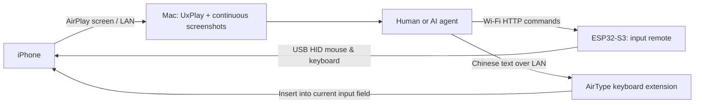

English | [简体中文](README.md)

<h1 align="center">iPhone Pilot</h1>

<p align="center"><strong>Give your agent an iPhone to use.</strong> See the screen, use your apps, and take the next step for you.</p>

<p align="center">
  <a href="#getting-started">Getting Started</a> ·
  <a href="docs/setup.md">Setup &amp; Flashing</a> ·
  <a href="docs/validation.md">Testing &amp; Limitations</a> ·
  <a href="https://github.com/yangyao/iphone-pilot/issues">Feedback</a>
</p>

> Note: the rest of the documentation (such as `docs/`) is written in Chinese.

The apps you use every day, the interfaces you know by heart, and the accounts already signed in all live on your phone. When you hand a task to an agent, those last few steps often still require you to pick up the phone and do them yourself.

iPhone Pilot wants to give your agent access to that phone as well. Connect a small board, mirror the screen to a Mac, and the agent can watch the real screen, tap, swipe, and type, then check the results and finish the task within the permissions you grant.

You hand over the task, and it carries on on the phone.

## Hand the work on your phone to your agent

For example: open a shopping app, find the question a buyer asked you, write a reply based on the experience you provide, then submit it and confirm the result. With this approach, we have walked through a complete JD.com buyer Q&A flow on a real iPhone.

The agent uses the apps and pages already on the phone. You decide what to do and provide the necessary information; it executes by observing the screen. Taking the Q&A as an example, you provide your actual experience, and the agent finds the question, types the reply, and verifies that it was published.

## See the screen, and act on it

To let an agent use a phone well, you need to connect "seeing the screen, performing actions, and confirming results."

iPhone Pilot continuously sends the phone's screen to the Mac so the agent can always read the latest screenshot; taps use coordinates from the screenshot to reduce repeated calibration of a relative mouse; after every page change or submission, it observes the result again and decides the next step.

The agent can now read the text and coordinates on the screen first, and only look at the original image when an icon is unclear. A background observation service continuously prepares OCR and writes completed results into SQLite, with screenshots saved by UTC time and frame index. Queries read the latest completed record directly and return the received time, frame age, and a stable image URL; images are fetched only when icons need to be recognized. By default the latest 1,000 records are kept, with old records and images cleaned up automatically. MCP tools return text by default; pass `include_image=true` to attach the image for the same frame. The fixed CLI also supports `--include-image` to fetch OCR and save the image locally in one call. [Observation API &amp; MCP integration →](docs/observation-api.md)

Chinese text input works in a single call as well: after the AirType keyboard is expanded, `iphone_type` automatically reads the current pairing info, connects, and types the whole passage, then checks that the text appears on screen. It only handles input; publishing still follows the task's authorization. [Chinese input &amp; auto pairing →](docs/chinese-input.md)

After a tap there is no need to separately wait for the screen and read the text: `iphone_act` can tap a target from the current observation, wait until the page content settles, and return the latest text, a summary of changes, and per-stage timings. When no confirmed change is detected, the status is reported explicitly, so a successful request is not mistaken for a completed task. [Action &amp; result API →](docs/action-api.md)

The agent only passes parameters while operating: prefer the MCP tools; when the current client has not loaded MCP, you can use fixed commands such as `./iphone observe` or `./iphone tap 12 --id p1 --wait 发布` directly, without generating request scripts for each step. [Fixed entry points →](docs/agent-entrypoints.md)

The repository also provides a reusable operation Skill that records the experience of Chinese input, candidate-word selection, and recovery from failed actions. When you switch to another agent, you can hand over this accumulated experience along with everything else.

## Optional icon localization

Hybrid mode merges **Apple Vision text recognition** and **Microsoft OmniParser V2 icon detection** into a single observation result, additionally returning bounding boxes, center coordinates, and confidence scores for text-free icons. This has been used in a real Taobao follow-up review, where a detected arrow's coordinates collapsed the keyboard and the publication was confirmed successful.

```sh
tools/setup-omniparser.sh
./iphone serve restart --api --parser-backend omniparser-hybrid
./iphone observe
# Switch back to text-only parsing
./iphone serve restart --api --parser-backend apple
```

This version provides icon locations but no automatic feature descriptions yet; `description` is null and `clickable` is not verified. Icons may be duplicated or missed, or an entire product row may be detected as an interactive area, so the original image should still be checked before acting. Hybrid mode uses a separate SQLite directory; the weights and the isolated Python environment are not committed. After local testing, this hybrid approach was kept, while a full EasyOCR replacement and per-icon descriptions were not adopted; the reasons and boundaries are described in the [experiment conclusions](docs/validation.md#解析后端实验结论). [Installation, result format &amp; limitations →](docs/observation-api.md)

## Chinese text, typed in one pass

When writing replies or filling in body text, the agent can use the AirType keyboard to send a whole Chinese passage straight into the current input field, preserving punctuation, digits, and English. The text travels over the local network — no pinyin candidate selection, cross-device clipboard, or cloud sync; the ESP32 continues to handle taps, swipes, and submissions.

This approach has been validated in the AirType test page, Apple Notes, and the JD.com Q&A flow. It requires installing and enabling the AirType keyboard once, and keeping its web input panel visible while typing; after switching, it may need to reconnect with the current code. **[Setup &amp; usage →](docs/chinese-input.md)**

## A small board that acts as the agent's hands

You can think of the ESP32 as a mouse and keyboard plugged into the phone. It does not run a large model and does not interpret the screen; the agent on the Mac handles observation and decisions, and the board carries out the input.



The screen and the commands travel along two paths: **the screen goes directly to the Mac, and control goes over Wi-Fi to the board, then over USB to the phone**. This path does not rely on Bluetooth pairing, but the board still needs a data-capable USB connection to the iPhone; powering the board alone is not enough for USB control.

Basic taps, swipes, and HID keyboard input require no companion app; the recommended full-passage Chinese input additionally needs the AirType keyboard. You need a Mac, a compatible ESP32-S3, and a data connection from the board to the phone. See the [setup &amp; connection guide](docs/setup.md) for hardware requirements.

## Getting Started

1. Prepare a Mac, an ESP32-S3 board with native USB HID support, a data cable, and an iPhone that accepts USB input devices. Only one ESP32-S3 with 16 MB Flash / 8 MB PSRAM has been verified so far.
2. Follow the [setup &amp; flashing guide](docs/setup.md) to install dependencies, fill in your local Wi-Fi and token, and build and flash the firmware.
3. Connect the board to the iPhone and enable AssistiveTouch; the Mac, phone, and board should join the same trusted local network.
4. Run `./iphone serve start` to launch the services, choose **iPhone Agent Mac** in the iPhone's Screen Mirroring menu, and run `./iphone observe` to read the latest screen.

**[Setup, flashing &amp; command examples →](docs/setup.md)**

## One entry point for local services

macOS launchd manages the receiver and the observation API, with launch-on-login and recovery from failures. The first start can specify the UxPlay and board configuration; later starts reuse the saved settings:

```sh
./iphone serve start --uxplay /ABSOLUTE/PATH/uxplay --board-host BOARD_IP --config /ABSOLUTE/PATH/secrets.h
./iphone serve status
./iphone serve restart --api
./iphone serve logs
./iphone serve stop
```

Status reports whether the services are ready, whether a new frame has arrived, and whether UxPlay has duplicate or orphaned processes. Restarting the API alone keeps the mirroring; after using `./iphone serve restart --receiver` to restart the receiver, you need to start mirroring from the phone again. UxPlay uses a single-instance lock and reclaims its child processes on exit. [Service management &amp; configuration →](docs/setup.md)

Actions by default wait for the screen to change and return the settled OCR and screenshot URL, which is usually enough to decide the next step. Use `--wait` to name text on the target page, e.g. `./iphone tap 12 --id open-review --wait 发布`. Results distinguish screen stability from target confirmation; publishing still requires checking the success page. [Wait conditions →](docs/action-api.md)

## Hand it to your own agent

Give the repository location and the [`iphone-mac-control` Skill](skills/iphone-mac-control/SKILL.md) to an agent that can run commands and view images. The Skill covers observation, coordinate-based input, Chinese candidate-word confirmation, and failure recovery; it does not provide a model itself and is not tied to any model vendor.

For example: "Use iphone-mac-control from this repository to open the specified app and view the page. Confirm the screen after each navigation, and perform submissions according to the task I authorized."

## Where things stand today

This is an experimental version validated on a single real iPhone. The full observe-act-submit flow has been completed end to end, but more devices and longer-term use still need testing. There is no downloadable universal firmware; for now you need to build it yourself.

| Capability | Current result |
| --- | --- |
| Absolute-coordinate taps, back, list dragging | Succeeded on the test phone |
| Swipe up from the bottom to go home | Succeeded; usable as a Home substitute |
| Spotlight shortcut, ASCII keyboard input | Succeeded |
| AirType full-passage Chinese input | Succeeded on the test page, two consecutive Notes passages, and the JD.com Q&A flow |
| Chinese pinyin input with candidate selection | Usable as a fallback; still requires word selection and checking |
| JD.com buyer Q&A | Completed one Chinese reply with "发布成功" (published successfully) shown |
| Taobao follow-up review | SQLite-based observation and post-action OCR flow completed on a real phone, with "评价成功" (review successful) confirmed |
| Consumer Home dedicated key | Command returned success, but the phone did not return to the home screen |
| All device models, long-running sessions, coexistence with legacy apps/BLE | Not yet sufficiently validated |

After AirType input, the text still needs to be checked; the fallback pinyin method still requires checking candidate words. Task speed is also affected by agent reasoning and the number of observation rounds. Absolute coordinates use the iOS AssistiveTouch pointer; system settings, orientation, and cropping can shift tap positions, and the first connection needs verification.

**[Full validation record &amp; known limitations →](docs/validation.md)**

## Origins &amp; License

This repository was created independently and is not a GitHub fork. The hybrid firmware is actually adapted from [Henry Yuan's ESP32 iPhone Agent](https://github.com/onehumanbeing/esp32-iphone-agent), adding absolute-coordinate HID, a token-protected LAN control interface, and this repository's desktop workflow; the original author's copyright notice is retained.

Thanks to [iPhone Use](https://github.com/xhoantran/iphone-use) for the inspiration on real-iPhone and agent interaction; this repository does not copy its Swift app code. Mac screen mirroring relies on the externally installed [UxPlay](https://github.com/FDH2/UxPlay), whose full repository is not bundled here.

This repository is released under [GPL-3.0](LICENSE), with the original MIT files kept under their corresponding licenses; the firmware contains upstream GPL AirPlay components. Creating an independent repository does not change the licensing obligations of copied code. See [THIRD_PARTY_NOTICES.md](THIRD_PARTY_NOTICES.md) for sources, versions, and the scope of modifications.
