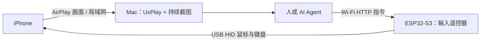

<h1 align="center">iPhone Pilot</h1>

<p align="center"><strong>把 iPhone 画面投到 Mac，用 ESP32 遥控真实手机。</strong></p>

<p align="center">
  <a href="#开始使用">开始使用</a> ·
  <a href="docs/setup.md">安装与刷机</a> ·
  <a href="docs/validation.md">实测与限制</a> ·
  <a href="https://github.com/yangyao/iphone-pilot/issues">反馈问题</a>
</p>

iPhone 通过 AirPlay 把画面直接传给 Mac，Mac 持续缓存最新截图。人或 AI Agent 根据截图发出点击、滑动和键盘指令，ESP32 再通过 USB 操作手机。无需在 iPhone 安装配套控制 App。

**直接投屏到 Mac · 绝对坐标点击 · USB 鼠标与键盘 · 可复用 Agent Skill**

当前是经过一台真实 iPhone 验证的实验版本，尚未建立完整机型兼容表，也没有可直接下载的通用固件。请先阅读[实测与限制](docs/validation.md)。

## 板子就是一个遥控器

可以把 ESP32 理解为插在手机上的鼠标和键盘。它不运行大模型，不负责理解画面；Mac 上的 Agent 负责观察和决策，板子负责执行输入。



画面和指令走两条通路：**画面直接到 Mac，控制经 Wi-Fi 到板子，再经 USB 到手机**。这条路径不依赖蓝牙配对，但板子仍需通过支持数据的 USB 连接 iPhone；只给板子供电不能完成这里的 USB 控制。

## 按截图坐标点击，减少反复校准

固件在原有相对鼠标、键盘功能旁加入绝对坐标指针。客户端把截图像素换算为 HID 坐标，再发送点击或拖动指令。在本次实测中，打开设置、返回、列表滚动和京东问答提交均不需要重新校准相对鼠标。

这仍然是 iOS 辅助触控下的 HID 指针输入，并非直接注入触摸事件。机型、系统设置、画面方向和裁剪可能影响坐标对应关系；首次使用必须观察点击效果。

## 让 Agent 持续看见画面

接收程序保持一个 UxPlay 进程，持续更新 `runtime/latest.jpg`，并提供仅监听本机的状态接口。Agent 不必为每一张截图重新启动命令。

```sh
python3 receiver.py --directory runtime -- python3 uxplay_source.py
```

在 iPhone 的“屏幕镜像”中选择 **iPhone Agent Mac**，然后查看：

```sh
curl -s http://127.0.0.1:18765/status
```

`file` 是最新截图路径，`sequence` 是接收帧编号。帧到达时间不等于端到端延迟；即使截图在更新，也要确认实际页面是否随操作变化。

## 开始使用

1. 准备 Mac、支持原生 USB HID 的 ESP32-S3 开发板、数据线，以及可连接 USB 输入设备的 iPhone。当前只验证了一块 16 MB Flash / 8 MB PSRAM 的 ESP32-S3。
2. 按[安装与刷机指南](docs/setup.md)安装依赖、填写本地 Wi-Fi 和 Token、编译并刷写固件。
3. 将板子接到 iPhone，开启辅助触控；Mac、手机与板子连接同一个可信局域网。
4. 启动接收程序，把 iPhone 镜像到 Mac，再从截图中取得坐标进行控制。

```sh
python3 hardware/tools/hybrid_control.py --host BOARD_IP status
python3 hardware/tools/hybrid_control.py --host BOARD_IP tap 192 645 --width 498 --height 1080
python3 hardware/tools/hybrid_control.py --host BOARD_IP swipe 250 855 250 420 --width 498 --height 1080 --ms 450
python3 hardware/tools/hybrid_control.py --host BOARD_IP command 'key cmd+space'
python3 hardware/tools/hybrid_control.py --host BOARD_IP command 'type 123'
```

示例坐标仅适用于当时的 498 × 1080 截图。实际操作必须使用自己的截图尺寸和目标位置。

## 交给自己的 Agent

把仓库位置和 [`iphone-mac-control` Skill](skills/iphone-mac-control/SKILL.md) 交给具备命令执行和图片查看能力的 Agent。Skill 包含观察、坐标输入、中文候选词确认和失败恢复经验；它本身不提供模型，也不绑定模型厂商。

例如：“使用这个仓库的 iphone-mac-control，打开指定 App 并查看页面。每次导航后确认画面，提交操作按我授权的任务执行。”

## 实测结果

| 功能 | 当前结果 |
| --- | --- |
| 绝对坐标点击、返回、列表拖动 | 在测试手机上成功 |
| 底部上滑返回桌面 | 成功，可作 Home 替代 |
| Spotlight 快捷键、ASCII 键盘输入 | 成功 |
| 中文拼音输入与候选词选择 | 成功，但仍需要选词和核对 |
| 京东买家问答 | 完成一条中文回答，出现“发布成功” |
| Consumer Home 专用按键 | 命令返回成功，但手机没有返回桌面 |
| 全机型、长时间运行、旧 App/BLE 共存 | 尚未充分验证 |

## 来源与许可证

这是独立创建的仓库，不是 GitHub Fork。混合固件实际改编自 [Henry Yuan 的 ESP32 iPhone Agent](https://github.com/onehumanbeing/esp32-iphone-agent)，新增绝对坐标 HID、带 Token 的 LAN 控制接口和本仓库的桌面工作流；保留原作者版权声明。

感谢 [iPhone Use](https://github.com/xhoantran/iphone-use) 对真实 iPhone 与 Agent 交互方式的启发，本仓库没有复制其 Swift 应用代码。Mac 投屏依赖外部安装的 [UxPlay](https://github.com/FDH2/UxPlay)，不在此打包其完整仓库。

本仓库按 [GPL-3.0](LICENSE) 发布，原有 MIT 文件保留对应授权；固件内含上游 GPL AirPlay 组件。独立建仓并不改变复制代码的许可证义务。具体来源、版本和修改范围见 [THIRD_PARTY_NOTICES.md](THIRD_PARTY_NOTICES.md)。
