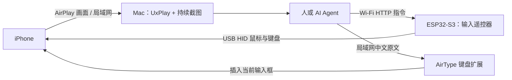

<h1 align="center">iPhone Pilot</h1>

<p align="center"><strong>让 Agent 用上你的 iPhone。</strong></p>

<p align="center">
  <a href="#开始使用">开始使用</a> ·
  <a href="docs/setup.md">安装与刷机</a> ·
  <a href="docs/validation.md">实测与限制</a> ·
  <a href="https://github.com/yangyao/iphone-pilot/issues">反馈问题</a>
</p>

你每天使用的 App、熟悉的界面和已经登录的账号，都在手机里。把任务交给 Agent 时，这些事情往往还需要你拿起手机，亲手完成最后几步。

iPhone Pilot 想让 Agent 也能用上这台手机。连接一块小板子，把画面投到 Mac，Agent 就能看着真实屏幕，点击、滑动、输入，再查看操作结果，在你授权的范围内完成任务。

你交代任务，它在手机上接着做。

## 把手机里的事情，交给 Agent 接着做

比如打开购物 App，找到买家向你提出的问题，根据你提供的使用体验写好回答，再提交并确认结果。我们已经用这套方式，在真实 iPhone 上走完了一次京东买家问答流程。

Agent 使用的是手机上现有的 App 和页面。你决定要做什么、提供必要的信息，它通过观察屏幕来执行。以这次问答为例，你提供实际使用感受，Agent 负责找到问题、输入回答并核对发布结果。

## 看得见，也操作得上

要让 Agent 用好手机，需要把“看见画面、执行动作、确认结果”连起来。

iPhone Pilot 持续把手机画面送到 Mac，让 Agent 随时读取最新截图；点击使用截图上的位置，减少反复校准相对鼠标；每次页面切换或提交之后，再观察结果，决定下一步。

现在 Agent 可以先读屏幕上的文字和坐标，遇到不明确的图标再看原图。后台观察服务持续准备 OCR，将已完成结果写入 SQLite，截图按 UTC 时间与影格序号保存。查询直接读取最新完成记录，返回接收时间、帧龄和固定图片地址；需要辨认图标时再取图。默认保留最近 1,000 笔，自动清理旧记录与图片。MCP 工具默认返回文字，传 `include_image=true` 才附带同一帧图片；固定 CLI 也可用 `--include-image` 一次取回 OCR 并把图片保存到本地。[观察 API 与 MCP 接入 →](docs/observation-api.md)

中文输入也能一次调用：展开 AirType 键盘后，`iphone_type` 自动读取当前配对信息，连接并输入整段正文，再检查文字是否出现在画面上。它只负责输入，发布仍按任务授权操作。[中文输入与自动配对 →](docs/chinese-input.md)

点击之后也不必再分开等画面、读文字：`iphone_act` 可以点选当前观察中的目标，等页面内容稳定，再带回最新文字、变化摘要和各阶段耗时。没有确认变化时会明确返回状态，避免把请求成功误当作任务完成。[动作与结果接口 →](docs/action-api.md)

Agent 操作时只传参数：优先调用 MCP 工具；当前客户端尚未加载 MCP 时，可直接用 `./iphone observe`、`./iphone tap 12 --id p1 --wait 发布` 等固定命令，不必每步生成请求脚本。[固定调用入口 →](docs/agent-entrypoints.md)

仓库也提供了可复用的操作 Skill，记录中文输入、候选词选择和操作失败后的处理经验。换一个 Agent 时，可以把这些已经走过的经验一起交给它。

## 可选的图示定位

混合模式将 **Apple Vision 的文字辨识**与 **Microsoft OmniParser V2 的图示侦测**合并到同一张观察结果，额外返回无文字图示的位置框、中心坐标与信心度。已在真实淘宝追评中使用侦测到的箭头坐标收起键盘，并确认发布成功。

```sh
tools/setup-omniparser.sh
./iphone serve restart --api --parser-backend omniparser-hybrid
./iphone observe
# 切回纯文字解析
./iphone serve restart --api --parser-backend apple
```

此版本提供图示位置，尚未启用自动功能描述；`description` 为 null，`clickable` 未验证。图示可能重复、漏检，或将商品整列识别为互动区域，操作前仍需结合原图确认。混合模式使用独立 SQLite 目录，权重与隔离 Python 环境不提交。完整 OCR 与图示描述模式仍在评估。[安装、结果格式与限制 →](docs/observation-api.md)

## 中文原文，一次输入

写回答、填正文时，Agent 可以通过 AirType 键盘把整段中文直接送进当前输入框，保留标点、数字和英文。文字走本地网络，不经过拼音选词、跨设备剪贴板或云同步；ESP32 继续负责点击、滑动和提交。

这条方式已在 AirType 测试页、苹果备忘录和京东问答中验证。需要一次安装并启用 AirType 键盘，输入时保持其网页输入面板显示；切换后可能需要按当前码重新连接。**[设置与使用 →](docs/chinese-input.md)**

## 一块小板子，接上 Agent 的手

可以把 ESP32 理解为插在手机上的鼠标和键盘。它不运行大模型，不负责理解画面；Mac 上的 Agent 负责观察和决策，板子负责执行输入。



画面和指令走两条通路：**画面直接到 Mac，控制经 Wi-Fi 到板子，再经 USB 到手机**。这条路径不依赖蓝牙配对，但板子仍需通过支持数据的 USB 连接 iPhone；只给板子供电不能完成这里的 USB 控制。

基础点击、滑动和 HID 键盘输入无需安装配套控制 App；推荐的整段中文输入另需 AirType 键盘。你需要一台 Mac、一块兼容的 ESP32-S3，以及把板子接到手机的数据连接。具体硬件要求见[安装与连接指南](docs/setup.md)。

## 开始使用

1. 准备 Mac、支持原生 USB HID 的 ESP32-S3 开发板、数据线，以及可连接 USB 输入设备的 iPhone。当前只验证了一块 16 MB Flash / 8 MB PSRAM 的 ESP32-S3。
2. 按[安装与刷机指南](docs/setup.md)安装依赖、填写本地 Wi-Fi 和 Token、编译并刷写固件。
3. 将板子接到 iPhone，开启辅助触控；Mac、手机与板子连接同一个可信局域网。
4. 使用 `./iphone serve start` 启动服务，在 iPhone 控制中心选择屏幕镜像 **iPhone Agent Mac**，执行 `./iphone observe` 读取最新画面。

**[安装、刷机与命令示例 →](docs/setup.md)**

## 一个入口管理本地服务

macOS 的 launchd 管理接收器与观察 API，支持登录后启动和异常恢复。首次启动可指定 UxPlay 与板子配置，后续启动复用已保存设置：

```sh
./iphone serve start --uxplay /ABSOLUTE/PATH/uxplay --board-host BOARD_IP --config /ABSOLUTE/PATH/secrets.h
./iphone serve status
./iphone serve restart --api
./iphone serve logs
./iphone serve stop
```

状态分别报告服务是否就绪、是否有新画面，以及 UxPlay 是否存在重复或孤立程序。API 单独重启保留投屏；使用 `./iphone serve restart --receiver` 重启接收器后，需要从手机重新投屏。UxPlay 使用单实例锁并在退出时回收子程序。[服务管理与配置 →](docs/setup.md)

操作默认等待画面变化并带回稳定后的 OCR 与截图地址，通常可以直接决定下一步。用 `--wait` 指定目的页文字，例如 `./iphone tap 12 --id open-review --wait 发布`。结果区分画面稳定和目标确认；发布仍需核对成功页。[等待条件 →](docs/action-api.md)

## 交给自己的 Agent

把仓库位置和 [`iphone-mac-control` Skill](skills/iphone-mac-control/SKILL.md) 交给具备命令执行和图片查看能力的 Agent。Skill 包含观察、坐标输入、中文候选词确认和失败恢复经验；它本身不提供模型，也不绑定模型厂商。

例如：“使用这个仓库的 iphone-mac-control，打开指定 App 并查看页面。每次导航后确认画面，提交操作按我授权的任务执行。”

## 现在能做到哪一步

当前是经过一台真实 iPhone 验证的实验版本。已经走通了观察、操作与提交的完整流程，还需要更多设备和长期使用的检验。没有可直接下载的通用固件，目前需要自行编译。

| 功能 | 当前结果 |
| --- | --- |
| 绝对坐标点击、返回、列表拖动 | 在测试手机上成功 |
| 底部上滑返回桌面 | 成功，可作 Home 替代 |
| Spotlight 快捷键、ASCII 键盘输入 | 成功 |
| AirType 整段中文输入 | 测试页、备忘录连续两段、京东问答均成功 |
| 中文拼音输入与候选词选择 | 可作备用，仍需要选词和核对 |
| 京东买家问答 | 完成一条中文回答，出现“发布成功” |
| 淘宝追评 | SQLite 观察与操作后 OCR 流程已在真实手机完成，确认“评价成功” |
| Consumer Home 专用按键 | 命令返回成功，但手机没有返回桌面 |
| 全机型、长时间运行、旧 App/BLE 共存 | 尚未充分验证 |

AirType 输入后仍需核对正文，备用拼音方式还需核对候选词。任务速度也会受 Agent 推理和观察轮次影响。绝对坐标使用的是 iOS 辅助触控指针；系统设置、画面方向和裁剪可能影响点击位置，首次连接需要验证。

**[完整验证记录与已知限制 →](docs/validation.md)**

## 来源与许可证

这是独立创建的仓库，不是 GitHub Fork。混合固件实际改编自 [Henry Yuan 的 ESP32 iPhone Agent](https://github.com/onehumanbeing/esp32-iphone-agent)，新增绝对坐标 HID、带 Token 的 LAN 控制接口和本仓库的桌面工作流；保留原作者版权声明。

感谢 [iPhone Use](https://github.com/xhoantran/iphone-use) 对真实 iPhone 与 Agent 交互方式的启发，本仓库没有复制其 Swift 应用代码。Mac 投屏依赖外部安装的 [UxPlay](https://github.com/FDH2/UxPlay)，不在此打包其完整仓库。

本仓库按 [GPL-3.0](LICENSE) 发布，原有 MIT 文件保留对应授权；固件内含上游 GPL AirPlay 组件。独立建仓并不改变复制代码的许可证义务。具体来源、版本和修改范围见 [THIRD_PARTY_NOTICES.md](THIRD_PARTY_NOTICES.md)。
